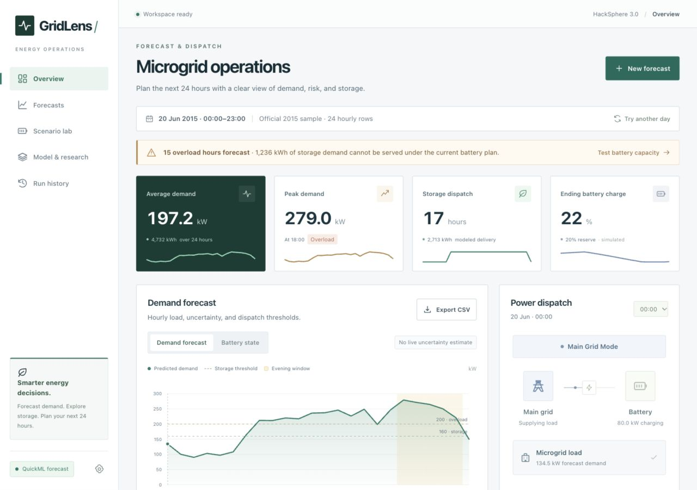
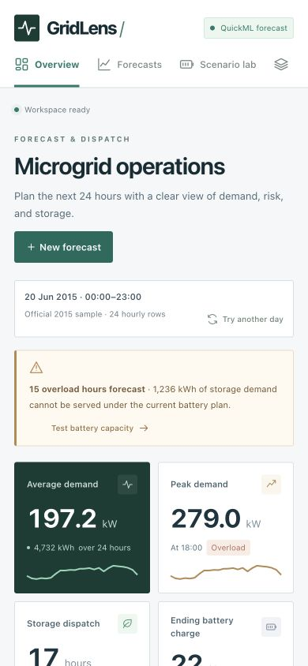
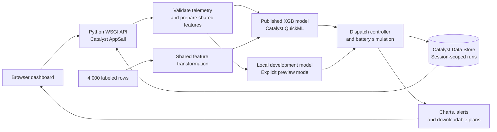

<div align="center">

# GridLens

### Microgrid demand forecasting and dispatch planning

A working Zoho Catalyst application that turns hourly weather telemetry into a 24-hour demand forecast, a power-source schedule, and a battery feasibility plan.

**Team neevmodh205 · Neev Modh · Solo participant · HackSphere 3.0**

[**Live application**](https://gridlens-50047133296.development.catalystappsail.in/) &nbsp; · &nbsp; [**Presentation PDF**](presentation/GridLens_neevmodh205.pdf) &nbsp; · &nbsp; [**Editable PowerPoint**](presentation/GridLens_neevmodh205.pptx) &nbsp; · &nbsp; [**Requirement audit**](docs/REQUIREMENTS_AUDIT.md) &nbsp; · &nbsp; [**Verification evidence**](docs/VALIDATION.md)


*Concept illustration. The application forecasts and simulates a microgrid; it does not operate physical equipment.*

</div>

## At a glance

| Item | Implementation |
| --- | --- |
| Cloud platform | Zoho Catalyst AppSail, QuickML and Data Store |
| Published model | XGB Regression, trained from 4,000 supplied labeled telemetry rows |
| Planning horizon | 24 consecutive hourly observations |
| Forecast inputs | Timestamp, ambient temperature, humidity and solar irradiance |
| Interface | Responsive operations dashboard, CSV/form ingestion and battery scenario lab |
| Saved runs | Durable, browser-session-scoped Catalyst Data Store records |
| Deliverables | Live website, full source, `predict(input_df)`, CSV CLI, presentation PDF and editable PowerPoint |
| Submission | **Confirmed** through the official HackSphere 3.0 form |
| Verification record | 24 October 2026: 36 tests passed, official 1,000-row evaluator returned `SUCCESS` using live QuickML |

**GridLens keeps forecast accuracy, policy compliance and battery feasibility separate.** The published model predicts demand. The controller applies the challenge’s exact rules. The battery simulation reports whether the selected storage plan can serve the scheduled load.

## Explore the project

[Product walkthrough](#product-walkthrough) · [Architecture](#architecture) · [Quick start](#quick-start) · [Input contract](#input-contract) · [Dispatch rules](#dispatch-rules) · [Model and evidence](#model-and-evidence) · [API](#api) · [Cloud configuration](#cloud-configuration) · [Project structure](#project-structure)

## Product walkthrough



1. Open the [live application](https://gridlens-50047133296.development.catalystappsail.in/). It restores the latest forecast available to your browser or generates a QuickML forecast from the official historical sample.
2. Choose **New forecast**. Upload or paste a CSV, or edit the hourly weather inputs. Supply 24 consecutive hours.
3. Inspect demand, overload hours and the source schedule. Select an hour to see its dispatch reason and simulated battery charge.
4. Open **Scenario lab** to compare battery assumptions against the same forecast. Scenarios reuse the saved predictions without another QuickML request.
5. Export the forecast CSV or the JSON control-signal log. **Run history** restores earlier forecasts from the same browser session.

The sample contains **2015 historical telemetry**, not current weather. The dashboard preserves the input dates and labels sample data explicitly.

<details>
<summary><strong>Mobile preview</strong></summary>
<br>


</details>

### What the application includes

| Capability | Behavior |
| --- | --- |
| Telemetry ingestion | CSV upload, drag and drop, paste, and an editable hourly form |
| Data preparation | Schema, timestamp, range and finite-number checks, plus training-median imputation |
| Demand visualization | Interactive demand and battery SOC charts with threshold overlays and hour selection |
| Dispatch planning | Exact source rules, hourly decisions, transition events and independent overload alerts |
| Battery analysis | Capacity, starting charge, reserve, efficiency and output-power limits |
| Scenario comparison | Baseline/candidate SOC, storage shortfall and forecast-specific capacity advice |
| Provenance | Explicit QuickML/local labels, input source, actual timestamps and model details |
| Downloads | Hourly dispatch CSV and 24 scheduled `SET_POWER_SOURCE` commands in JSON |

## Architecture



The frontend uses HTML, CSS, JavaScript and SVG. AppSail serves it alongside the Python API through Gunicorn. Training export and inference use the same feature transformation. No target labels or unavailable future-demand lags enter the feature vector.

Hosted requests use managed AppSail credentials for QuickML and Data Store. Unconfigured local development uses the checked-in preview model and SQLite. A QuickML failure produces an explicit error; it never silently substitutes local predictions.

## Quick start

### Run the local dashboard

Requires **Python 3.10 or later**. Python 3.12 matches the deployed runtime. The local preview needs no cloud credentials, dependency installation or frontend build.

```sh
git clone https://github.com/neevmodh/GridLens.git
cd GridLens
python3 app.py
```

Open **http://127.0.0.1:8080**. The local server binds to loopback. Set `PORT` to use another port.

### Generate predictions using live QuickML

The prediction script calls the deployed application by default. It needs no Zoho credentials on your computer.

```sh
python3 predict.py --input sample_test_input.csv --output predictions.csv
```

Output has exactly these columns:

```csv
timestamp,target_demand_kw
```

`predict(input_df)` accepts the evaluator’s pandas DataFrame or a list of row dictionaries and returns one finite numeric value per row in its original order. The CLI accepts 1–1,000 rows. It divides hosted inference into requests of at most 100 rows, so 1,000 input rows use ten upstream batches with the deployed configuration.

Input telemetry goes to the selected prediction service. Service availability and account usage limits apply. `GRIDLENS_PREDICT_URL` overrides the hosted relay URL. Configured direct QuickML OAuth credentials take precedence over the relay.

For an explicit local development prediction:

```sh
python3 predict.py --input sample_test_input.csv --output predictions-local.csv --local-preview
```

### Run the original evaluator

```sh
python3 -m venv .venv
.venv/bin/python -m pip install -r requirements-eval.txt
PREDICT_ALLOW_LOCAL=0 .venv/bin/python test_eval.py
```

The original organizer evaluator and sample input remain byte-identical to the starter kit. The recorded live run returned **`SUCCESS` for all 1,000 rows**. This check establishes output shape, count and finiteness; it does not measure hidden-test accuracy.

## Input contract

| Column | Meaning | Accepted input |
| --- | --- | --- |
| `timestamp` | Hour used by calendar features and dispatch rules | `YYYY-MM-DD HH:MM:SS`, on the hour |
| `ambient_temp_c` | Ambient temperature in °C | −60 to 65 |
| `humidity_pct` | Relative humidity in % | 0 to 100 |
| `solar_irradiance_wm2` | Solar irradiance in W/m² | 0 to 1,500 |

The dashboard requires **exactly 24 rows in ascending order, one hour apart**, with no gaps or duplicates. The prediction function accepts independent rows and preserves their supplied order. Blank weather cells, `None` and floating-point NaN values use medians from the training dataset. Missing required columns, malformed numbers, infinity and out-of-range inputs fail validation.

Timestamps represent timezone-unspecified wall-clock values. The controller uses the hour as supplied and does not convert it to the browser’s timezone.

## Dispatch rules

| Condition | Required result |
| --- | --- |
| Demand **>160 kW** **OR** hour **18–22 inclusive** | `renewable_storage` |
| Neither storage condition applies | `main_grid` |
| Demand **≥200 kW** | Independent critical overload alert |

At exactly **160 kW**, the demand threshold alone does not select storage. At **18:00** and **22:00**, the evening override applies. The overload check runs independently of source selection.

### Battery model

Each row spans one hour. Demand in kW multiplied by that hour gives energy in kWh.

| Setting | Default |
| --- | ---: |
| Capacity | 4,000 kWh |
| Initial charge | 80% |
| Protected reserve | 20% |
| Grid charging rate | 80 kW |
| Maximum discharge | 350 kW |
| Charge/discharge efficiency | 95% |

Storage delivery respects available energy above reserve, discharge efficiency and output-power limits. Main-grid hours serve the load from the grid and recharge the battery at the configured rate. Solar irradiance is a forecasting feature; the simulator does not invent panel capacity or solar generation.

A shortfall alert identifies storage demand the battery cannot serve. It does **not** rewrite the required dispatch mode. Capacity advice estimates feasibility for the selected forecast and assumptions, without optimizing market costs or sizing an installation across a full year. Exported control commands have `dry_run: true` and no connection to physical hardware.

## Model and evidence

### Published QuickML model

| Metric | Recorded result |
| --- | ---: |
| RMSE | **8.2733 kW** |
| MAE | **6.54336 kW** |
| R² | **0.97293** |
| Supplied labeled training rows | **4,000** |

These results come from **QuickML’s built-in model evaluation**, whose split AutoML controls. They are not a competition hidden-test score. Exact model identifiers and metric provenance are in [quickml-evaluation.json](models/quickml-evaluation.json).

### Verification record

| Check | Recorded outcome | Evidence |
| --- | --- | --- |
| Unit and API checks | 36 passed | [Verification record](docs/VALIDATION.md) and [tests](tests/test_energy.py) |
| Original evaluator, live QuickML | `SUCCESS`, 1,000 rows, local preview disabled | [Self-test transcript](validation/official-self-test.txt) |
| Full CSV CLI, live QuickML | 1,000 finite predictions, exact headers and timestamp order | [Prediction CSV](validation/quickml_predictions.csv) and [hashes/metadata](validation/live-evaluation.json) |
| Saved forecast durability | Restored after a physical AppSail redeployment | [Redeployment check](validation/history-redeployment.txt) |
| Session isolation | Different browser session received HTTP 404 for a saved run | [Verification record](docs/VALIDATION.md) |
| Mobile layout | 390-pixel page width with no horizontal page overflow | [Mobile preview](docs/mobile-preview.png) |

Run the local checks:

```sh
python3 -m unittest discover -s tests -v
node --check static/app.js
```

### Local benchmark and reproducibility

The local preview selects a weather/hour-interaction regression through expanding chronological folds and a one-standard-error simplicity policy. On the same later 800-row development segment, it reports **9.2494 kW RMSE**, compared with **11.7753 kW** for the original ridge baseline, a **21.45% reduction**. Its MAE is **7.4241 kW**.

These are retrospective development comparisons. The local benchmark and QuickML evaluation use different splits and cannot establish a direct ranking between the served models.

```sh
python3 -m venv .venv-training
.venv-training/bin/python -m pip install -r requirements-training.txt
.venv-training/bin/python scripts/benchmark.py
python3 scripts/prepare_quickml.py
```

The comparison and selection policy live in [benchmark.json](models/benchmark.json). `scripts/prepare_quickml.py` exports the shared engineered features plus the target to `data/quickml_training.csv`.

The local preview can display a **90% empirical residual reference band**, with a recorded 17.3449 kW radius and 94.62% coverage on a later development segment. Temporal dependence, seasonal shift and final refitting prevent any guaranteed future coverage claim. QuickML predictions do not inherit that local interval.

Research and implementation decisions: [forecasting methods, chronological validation and battery feasibility](docs/RESEARCH.md).

## API

All API routes share the application origin. POST routes accept `application/json` and reject bodies larger than 1 MB. Saved runs belong to the session cookie, so retain the same cookie when listing, restoring or exporting them.

| Method | Route | Purpose |
| --- | --- | --- |
| GET | `/api/health` | Service/configuration metadata, recorded model metrics and history backend |
| GET | `/api/sample?offset=9` | 24 consecutive rows from the supplied historical sample |
| POST | `/api/forecast` | Validate 24 rows, predict, evaluate dispatch, simulate battery and save a run |
| POST | `/api/predict` | QuickML inference for 1–100 independent rows, preserving order |
| POST | `/api/scenario` | Compare battery settings for an existing `run_id` without new model inference |
| GET | `/api/history` | Up to 20 recent runs for the session |
| GET | `/api/runs/<id>` | Restore a session-owned forecast |
| GET | `/api/runs/<id>/export` | Download the complete dispatch CSV |
| GET | `/api/runs/<id>/signals` | Download scheduled commands and events as JSON |

A forecast body contains `rows` or a `csv` string, `provider` (`quickml` or `local_preview`), and optional `battery` settings. The scenario body contains `run_id` and `battery`. The inference relay accepts `rows`.

<details>
<summary><strong>Executable local forecast example</strong></summary>

Start `python3 app.py` in another terminal, then run:

```sh
python3 - <<'PY'
import json
from urllib.request import Request, urlopen

base = 'http://127.0.0.1:8080'
with urlopen(base + '/api/sample?offset=9') as response:
    rows = json.load(response)['rows']
payload = {'provider': 'local_preview', 'rows': rows}
request = Request(base + '/api/forecast',
                  data=json.dumps(payload).encode(),
                  headers={'Content-Type': 'application/json'}, method='POST')
with urlopen(request) as response:
    run = json.load(response)
print(json.dumps({'id': run['id'], 'summary': run['summary']}, indent=2))
PY
```

Change the provider to `quickml` only on a server configured for live QuickML.

</details>

The API reports validation errors as HTTP **422**, upstream inference failures as **502**, and cloud-history failures as **503**. `/api/health` reports configuration presence; a successful QuickML forecast verifies actual connectivity.

## Cloud configuration

The existing demo runs on **Catalyst AppSail, Python 3.12, 256 MB**, in the India data center’s Development environment. Its published QuickML model and durable Data Store history are configured. [Cloud status](docs/CLOUD_STATUS.md) records the deployment identifiers.

| Variable | Hosted configuration / purpose |
| --- | --- |
| `GRIDLENS_PUBLIC_ORIGIN` | Exact public HTTPS application origin |
| `GRIDLENS_HISTORY_TABLE` | `92358000000019001` for this deployment’s `GridLensRuns` table |
| `GRIDLENS_DATA_DIR` | `/tmp/gridlens` for temporary/local fallback storage |
| `QUICKML_AUTH_MODE` | `catalyst` for request-scoped managed authentication |
| `QUICKML_PROJECT_ID` | `92358000000016001` for this deployment |
| `ZOHO_ORG_ID` | `60093095288` for this deployment |
| `QUICKML_FEATURE_SCHEMA` | `engineered`, matching the exported training features |
| `QUICKML_REQUEST_MODE` | `batch`, verified against the published endpoint |
| `QUICKML_ENDPOINT_KEY` | Private endpoint key, supplied only through server configuration |

Local preview requires none of these variables. For a separate deployment, use its own project/table identifiers, public origin and endpoint key. For direct local QuickML access, copy [.env.example](.env.example) to `.env` and follow the [QuickML setup guide](docs/QUICKML_SETUP.md). Process environment variables take precedence over `.env`.

The checked-in `app-config.json` contains **non-secret configuration only**. Preserve private runtime variables when redeploying: a linked CLI deployment can replace the environment configuration. The current demo uses the console-managed deployment workflow.

### Storage and access

Hosted history uses Data Store with USER scope, server-only SELECT/INSERT permissions and a SHA-256 session-ownership filter on every lookup. Local development uses SQLite. The browser cookie is HttpOnly and SameSite=Lax, carries a seven-day max-age, and uses Secure on the configured HTTPS deployment. Clearing or expiring it removes that browser’s access to its saved runs.

Records retain parsed telemetry and forecasts. Raw uploaded files are not archived separately. Public forecasting is available for the demo; the application does not implement user accounts or a per-user inference quota. Additional access and usage controls would be needed for an unrestricted long-term service.

### Build and deploy

Use Python 3.12 when preparing the AppSail bundle:

```sh
python3 scripts/package.py --install-deps --zip
```

This creates `GridLens_AppSail.zip` with runtime code and universal-wheel dependencies. The startup command is:

```sh
python3 -m gunicorn -c gunicorn.conf.py app:application
```

Gunicorn reads Catalyst’s assigned `X_ZOHO_CATALYST_LISTEN_PORT`. Build contents, console deployment and verification steps are in the [Catalyst deployment guide](docs/CATALYST_DEPLOYMENT.md).

For a source archive:

```sh
python3 scripts/package.py --source
```

`GridLens_Source.zip` includes the source, documentation, presentation and validation evidence. It excludes credentials, local environments, runtime databases and deployment build directories.

## Project structure

```text
GridLens/
├── app.py                      # WSGI API, static serving and run orchestration
├── predict.py                  # Organizer inference function and CSV CLI
├── energy/
│   ├── telemetry.py            # CSV parsing and input validation
│   ├── features.py             # Shared training/inference feature preparation
│   ├── quickml.py              # QuickML adapter and response validation
│   ├── catalyst.py             # Managed cloud authentication
│   ├── controller.py           # Dispatch rules, battery model and command log
│   ├── analytics.py            # Diagnostics and capacity feasibility advice
│   └── history.py              # Durable session-scoped cloud history
├── static/                     # Responsive frontend and SVG charts
├── data/                       # Supplied training data and engineered export
├── models/                     # Local model, benchmark and QuickML provenance
├── scripts/                    # Training, comparison and packaging tools
├── tests/                      # Unit and API verification
├── validation/                 # Official evaluator and live inference evidence
├── docs/                       # Research, setup, requirement audit and screenshots
└── presentation/               # Submission PDF, PowerPoint, images and slide previews
```

## Presentation and documentation

- [7-page presentation PDF](presentation/GridLens_neevmodh205.pdf): the presentation in the format required by the submission form, with clickable demo and repository links.
- [Editable PowerPoint](presentation/GridLens_neevmodh205.pptx): product screenshots, editable diagrams, a native forecast chart and speaker notes.
- [Submission record](docs/SUBMISSION.md): the confirmed form response and submitted deliverables.
- [Requirement audit](docs/REQUIREMENTS_AUDIT.md): mapping from the challenge requirements to implementation and verification.
- [Validation record](docs/VALIDATION.md): completed checks and their practical limits.
- [Cloud deployment record](docs/CLOUD_STATUS.md): deployed services, model and history configuration.
- [Research and design decisions](docs/RESEARCH.md): source references, local benchmarks and simulation assumptions.
- [QuickML setup](docs/QUICKML_SETUP.md) and [AppSail deployment](docs/CATALYST_DEPLOYMENT.md): configuration and reproducibility guides.

## Submission status

**Submitted successfully through the official HackSphere 3.0 project form.** Google Forms displayed **“Your response has been recorded.”**

The submission used team **neevmodh205**, solo participant **Neev Modh**, the public Catalyst application, the GitHub repository and the seven-page PDF presentation. The extra team-member fields remained blank. See the [submission record](docs/SUBMISSION.md).

The original evaluator passed using live QuickML. The repository retains the source, setup guides, verification evidence and editable presentation. Hidden-test accuracy and competition results remain unknown.

Built by **Neev Modh**, solo participant under team name **neevmodh205**.
