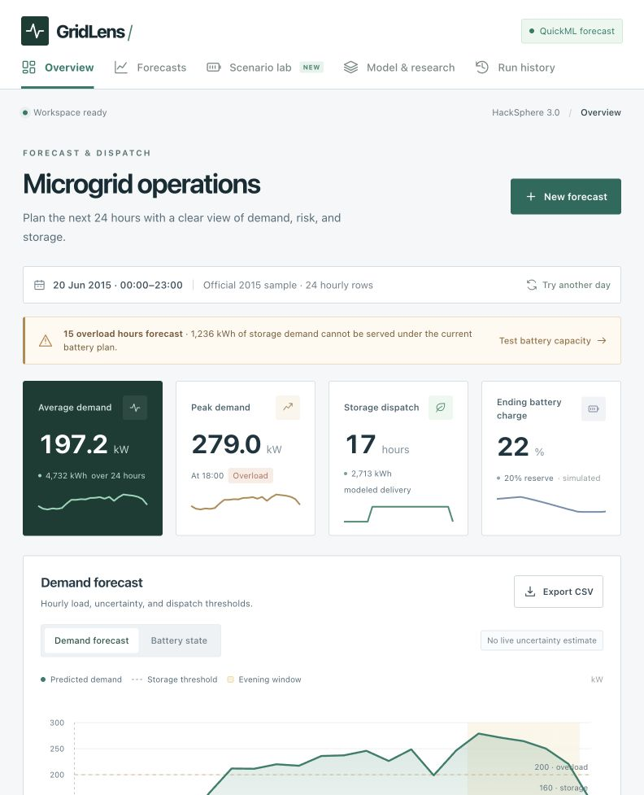

# GridLens — Microgrid Intelligence

**Team: neevmodh205**  
**Participant: Neev Modh (solo)**

A deployed HackSphere 3.0 application: ingest 24 hourly weather rows, forecast demand, evaluate the official grid switching rules, simulate battery state, inspect alerts, and export the dispatch plan.

**Repository:** https://github.com/neevmodh/GridLens

**Presentation:** [7-slide PowerPoint](presentation/GridLens_neevmodh205.pptx)

**Live website:** https://gridlens-50047133296.development.catalystappsail.in

**Cloud model:** a published Catalyst QuickML XGBoost regression model trained from the 4,000 supplied labeled rows. QuickML's built-in evaluation reports **8.2733 kW RMSE**, **6.54336 kW MAE** and **R² 0.97293**. A complete hosted 24-hour QuickML forecast and the unchanged official 1,000-row self-test have been verified with live predictions. These metrics are not a hidden-test score or the chronological local-model benchmark. See [deployment record](docs/CLOUD_STATUS.md).



## Research-informed version 2

The interface now uses a full-width operations layout with larger charts and readable navigation. New features include an empirical uncertainty reference band, threshold-watch diagnostics, training-range checks, a battery scenario lab, minimum-capacity feasibility estimates, and an in-app model/research page.

The selected weather/calendar regression reaches **9.2494 kW RMSE** and **7.4241 kW MAE** on the same 800-row chronological development holdout used for the original baseline (**11.7753 kW RMSE**). This is about a 21% RMSE reduction. These are retrospective development results, not an untouched external test or QuickML result. See [research and decisions](docs/RESEARCH.md), [benchmark results](models/benchmark.json), and [next Zoho steps](docs/ZOHO_NEXT_STEPS.md).

## Run locally

Python 3.10 or newer is required. The local application uses the Python standard library and needs no dependency installation or frontend build.

```sh
cd gridlens
python3 app.py
```

Open <http://127.0.0.1:8080>. If you are already inside this directory, omit `cd gridlens`. Set `PORT` to choose another port. The local server binds to loopback by default.

The hosted app opens the latest saved forecast, or generates a live QuickML forecast using 24 official historical sample rows. A local server without cloud configuration uses the explicitly labeled local preview. These are 2015 data, not live weather. Every new run records its actual input timestamps. Use **New forecast** to upload or paste a CSV, edit hourly weather inputs, choose QuickML, and change battery assumptions.

Timestamps are treated as timezone-unspecified wall-clock values; the hour in the supplied text controls the evening rule. The dashboard preserves those times without converting them to the browser's timezone.

## Included functionality

- Responsive dashboard with forecast chart, threshold overlays, hourly source schedule, selected-hour dispatch, battery state, and actionable insights.
- CSV upload, drag and drop, paste, and editable 24-hour telemetry form.
- Server-side validation of schema, consecutive hourly timestamps, numeric ranges, missing weather values, and battery settings.
- Blank weather cells and DataFrame NaN values are imputed from the labeled training dataset's medians. Infinite values, invalid numbers, gaps, and duplicate dashboard timestamps are rejected.
- Exact official switching rules: demand **> 160 kW OR hour 18–22 inclusive** uses storage; otherwise main grid. Demand **≥ 200 kW** independently raises a critical alert.
- Forecast explorer with storage/overload filters, browser-scoped run history, restore, and CSV export.
- Selected weather/calendar model with a reproducible rolling-origin comparison and chronological validation result, plus a configurable server-only QuickML adapter with optional OAuth refresh.
- Submission-compatible `predict(input_df)` and `--input` / `--output` CSV interface. No silent local fallback in QuickML mode.

## Architecture

```text
Browser: static HTML / CSS / JavaScript + SVG chart
  └── Python WSGI API
        ├── Shared telemetry validation and feature preparation
        ├── Explicit local preview OR published QuickML REST endpoint
        ├── Official transition controller
        ├── Battery simulation and overload/shortfall events
        └── Session-isolated Catalyst Data Store history (SQLite for local development)
```

The same Python feature transformation is used for QuickML training export and inference. No actual demand values, future demand labels, or unavailable lagged demand are used as input features.

### API

| Route | Purpose |
| --- | --- |
| `GET /api/health` | Local model metadata and configuration presence; does not claim live QuickML connectivity |
| `GET /api/sample?offset=9` | A consecutive 24-row window from the supplied unlabeled sample |
| `POST /api/scenario` | Compare battery settings for an existing run without changing its forecast or calling QuickML again |
| `POST /api/forecast` | Validate, predict, apply dispatch rules, simulate battery, and record a run |
| `POST /api/predict` | Live QuickML predictions for 1–100 independent rows, preserving order; used by the evaluator script |
| `GET /api/history` | Up to 20 recent runs belonging to the browser cookie |
| `GET /api/runs/<id>` | Restore a run belonging to the browser cookie |
| `GET /api/runs/<id>/export` | Download its full dispatch CSV |
| `GET /api/runs/<id>/signals` | Download 24 scheduled switching commands and independent alerts as JSON |

Forecast JSON body:

```json
{
  "provider": "local_preview",
  "rows": [
    {"timestamp": "2026-10-24 00:00:00", "ambient_temp_c": 28.5, "humidity_pct": 65, "solar_irradiance_wm2": 0}
  ],
  "battery": {"capacity_kwh": 4000, "initial_soc_pct": 80, "reserve_pct": 20, "charge_kw": 80, "max_discharge_kw": 350, "efficiency": 0.95}
}
```

Supply **24 consecutive hourly rows**, not just the illustrative row above. Alternatively replace `rows` with a `csv` string. Set `provider` to `quickml` for the published model.

## Connect QuickML

Follow [docs/QUICKML_SETUP.md](docs/QUICKML_SETUP.md) to train, publish, configure, and verify your actual model. Copy `.env.example` to `.env` for local credentials, or configure environment variables in Catalyst. `.env` is ignored and never served or included in deployment packages.

The endpoint's generated sample request is authoritative: request wrappers and batch support can vary. The adapter supports one raw record per call or a list of records, an optional input wrapper, raw or engineered features, and the documented `result[].prediction` response plus the starter `predictions[]` format. Verify these settings with your endpoint before submission.

QuickML errors are returned explicitly; credentials never go to the browser. A successful live forecast establishes a live connection. The health endpoint only says whether configuration is present.

### Hosted environment settings

The deployed AppSail service uses these settings. Keep the endpoint key in Catalyst’s private environment settings; it is intentionally absent from the source archive.

| Variable | Deployed value / purpose |
| --- | --- |
| `GRIDLENS_PUBLIC_ORIGIN` | `https://gridlens-50047133296.development.catalystappsail.in` |
| `GRIDLENS_HISTORY_TABLE` | `92358000000019001` — durable saved forecasts |
| `GRIDLENS_DATA_DIR` | `/tmp/gridlens` — temporary working directory |
| `QUICKML_AUTH_MODE` | `catalyst` — managed AppSail authentication |
| `QUICKML_PROJECT_ID` | `92358000000016001` |
| `ZOHO_ORG_ID` | `60093095288` |
| `QUICKML_FEATURE_SCHEMA` | `engineered` |
| `QUICKML_REQUEST_MODE` | `batch` |
| `QUICKML_ENDPOINT_KEY` | Private published endpoint key, server only |

Local preview requires none of these variables. Evaluator users can call the deployed relay without credentials. For a new deployment, configure its own project/table IDs, origin and private endpoint key; see the linked deployment guide. The non-secret `app-config.json` template must not replace existing private environment settings without preserving the endpoint key.

## Prediction script and evaluator

Live inference through the deployed application, with no credentials copied to your machine:

```sh
python3 predict.py --input sample_test_input.csv --output predictions.csv
```

Output columns are exactly `timestamp,target_demand_kw`. One prediction is emitted per input row in its original order. The CLI accepts up to 1,000 rows; the dashboard requires a 24-row window. The function accepts the supplied evaluator's pandas DataFrame or a list of row dictionaries.

By default the script calls the public app's `/api/predict` relay in chunks of at most 100 rows. The relay calls the published QuickML model using AppSail's managed credentials and never substitutes local predictions. `GRIDLENS_PREDICT_URL` can point to another deployment. Direct QuickML OAuth configuration takes precedence when present. Input telemetry is sent to the selected service; credentials remain on the server. Availability and QuickML quota still apply: the deployed batch mode sends ten upstream batch requests for 1,000 rows. Both the official self-test and the full CSV CLI have passed against this deployed model. Account usage and service availability still apply.

Explicit local development test:

```sh
python3 predict.py --input sample_test_input.csv --output predictions.csv --local-preview
```

The original supplied evaluator requires numpy and pandas:

```sh
python3 -m venv .venv
.venv/bin/python -m pip install -r requirements-eval.txt
PREDICT_ALLOW_LOCAL=1 .venv/bin/python test_eval.py
```

The local flag only verifies the evaluator's output contract. Before final submission, leave `PREDICT_ALLOW_LOCAL=0` and run against the hosted QuickML service when sufficient inference quota is available:

```sh
.venv/bin/python test_eval.py
```

Passing `test_eval.py` establishes output shape/count/finiteness, not accuracy or successful cloud deployment.

## Model training and reproducibility

The checked-in selected model is ready to use without scientific inference dependencies. To reproduce the comparison:

```sh
python3 -m venv .venv-training
.venv-training/bin/python -m pip install -r requirements-training.txt
.venv-training/bin/python scripts/benchmark.py
python3 scripts/prepare_quickml.py
```

The benchmark compares the original ridge, a richer weather/hour-interaction regression, boosted trees, and a ridge-plus-residual-boosting model. Two expanding chronological folds use 1,600→400 and 2,400→400 rows. A simplicity rule selects the least complex model within one fold standard error of the lowest rolling RMSE. A later 800-row development holdout reports comparison error; the final point model is refitted on all 4,000 labeled rows.

A 400-row chronological calibration segment supplies an absolute-residual reference radius of **17.3449 kW**. Its empirical coverage on the later development segment is **94.62%**. The UI labels this as a 90% empirical residual reference band; temporal dependence, seasonal changes, and final refitting mean it has **no guaranteed future coverage**. The local band is never attached to a different QuickML model.

The selected model and report are stored in `models/local-preview.json` and `models/benchmark.json`. All candidate models that use trees are exported and checked against scikit-learn during benchmarking; serving does not require scikit-learn.

`python3 scripts/train_local.py` reproduces the original baseline into `models/legacy-preview.json` without replacing the selected model.

`data/quickml_training.csv` contains the exact richer engineered feature columns plus the target. Set `QUICKML_FEATURE_SCHEMA=engineered` for a QuickML model trained on that export. Raw-schema endpoints still accept only the original four input columns. No unprovided demand lags or future labels are used.

## Battery simulation assumptions

Battery charge is a planning simulation, not measured hardware state. Each row is one hour; demand in kW times one hour gives load energy in kWh.

- In storage mode, delivered power is the minimum of demand, discharge power limit, and usable energy above reserve times discharge efficiency.
- Stored energy decreases by delivered energy divided by efficiency.
- In main grid mode the grid serves the load; the battery charges at the chosen grid charging rate, subject to capacity and charge efficiency.
- Solar irradiance is a forecasting feature, not an assumed battery charging power. No unprovided panel area or solar conversion model is invented.
- Insufficient battery capacity emits a shortfall alert. It **does not change** the mandated grid-mode output.
- The app emits plans and simulation results; it has no connection to actual switching hardware.

## Checks

```sh
python3 -m unittest discover -s tests -v
node --check static/app.js
```

36 tests cover exact threshold boundaries, independent overloads, inclusive evening hours, battery energy balance and reserve, missing-value cleanup, invalid data, response parsing, ordered QuickML calls, no silent fallback, API persistence/export/session isolation, and static-file access restrictions.

## Catalyst deployment

See [docs/CATALYST_DEPLOYMENT.md](docs/CATALYST_DEPLOYMENT.md). Production serves the same frontend and API through AppSail and Gunicorn. The example configuration reads Catalyst's assigned listen port and uses Python 3.12. Runtime dependencies must be included in the uploaded build.

Hosted history uses Catalyst Data Store table `GridLensRuns`, with USER scope, server-only SELECT/INSERT access, and a SHA-256 browser-session ownership check on every lookup. Records survive instance restarts and redeployments. Local development uses SQLite. The browser cookie expires after seven days; clearing it removes access to that browser’s saved runs. Parsed telemetry and forecasts are retained; raw uploaded files are not archived separately. Stratus and Slate are recommendations in the brief; the required public deployment supports AppSail, which serves this frontend and backend together.

## Final submission checklist

- [x] Train and publish the team QuickML regression model.
- [x] Verify the endpoint request shape, engineered feature schema, managed authentication, and prediction response.
- [x] Run the dashboard and the original evaluator in live QuickML mode.
- [x] Deploy to Zoho Catalyst and verify the public URL end to end.
- [x] Include full frontend/backend, `predict.py`, `energy/`, `models/`, and this README in the repository or source ZIP.
- [x] Keep all credentials out of source control and archives.
- [ ] Submit the public app URL and public repository/source ZIP through the official form by **28 October 2026**. The email does not specify a cutoff time or timezone.

Official references: [QuickML endpoint authentication](https://docs.catalyst.zoho.com/en/quickml/help/pipeline-endpoints/), [QuickML inference response](https://docs.catalyst.zoho.com/en/sdk/python/v1/quickml/execute-custom-ml-endpoint/), [AppSail configuration](https://docs.catalyst.zoho.com/en/serverless/help/appsail/appsail-configurations/).

## Submission readiness

The original, byte-identical organizer self-test returned **SUCCESS on all 1,000 rows using live QuickML**, with local preview disabled. The full CLI also produced exactly 1,000 finite predictions with the original timestamp order and required two-column CSV. Evidence and output are in `validation/`; the requirement-by-requirement mapping is in `docs/REQUIREMENTS_AUDIT.md`.

Submit the public application URL above with `GridLens_Submission.zip`. The package includes frontend/backend code, the configured prediction script, original evaluator and sample inputs, training data, README, research and verification evidence. It excludes credentials, local environments and runtime databases. The organizer’s deadline is 28 October 2026; no cutoff time was supplied.
